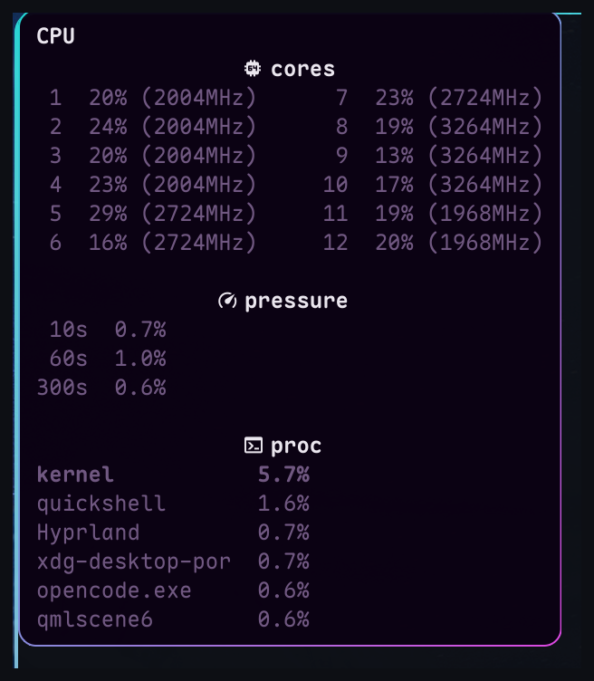
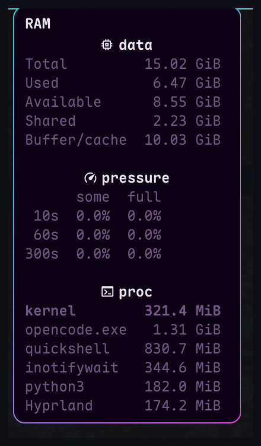
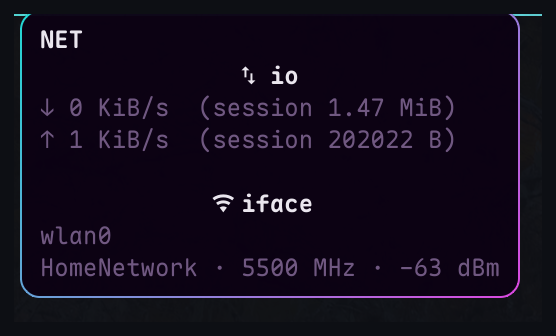
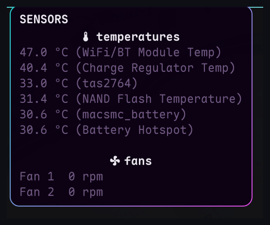
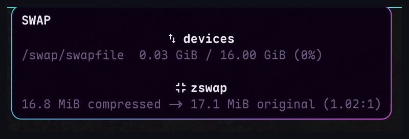
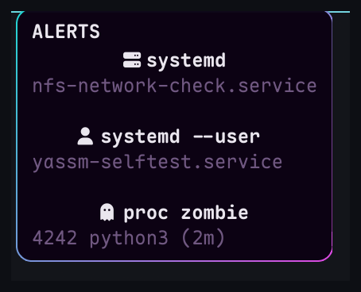
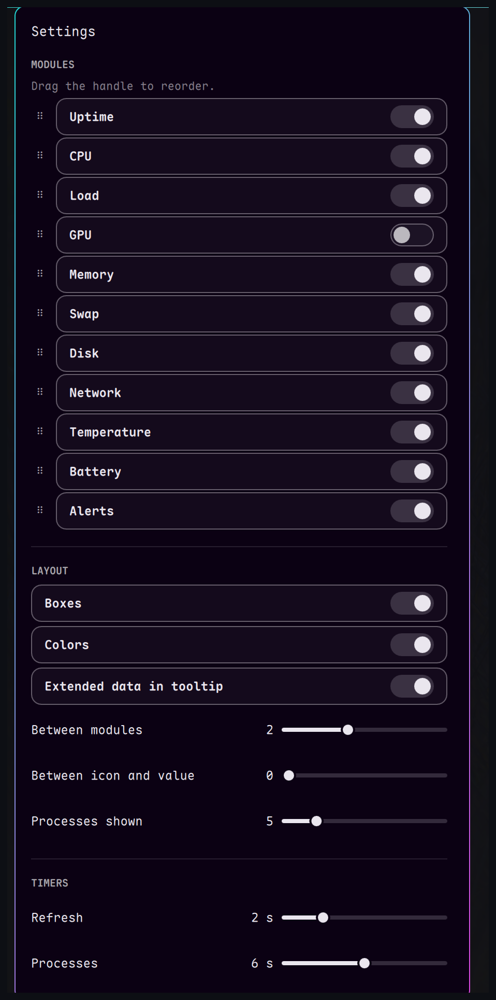

# YASSM — Yet Another Simple System Monitor

Version 1.27.5

[English](README.md) | **Français**

Widget de barre Omarchy affichant l'uptime, CPU, RAM, swap, charge système,
réseau, température, GPU, batterie, alertes et usage de la partition racine.

Dépôt : <https://github.com/jotenakis2/yassm>

## Captures d'écran


| Tooltips | |
| --- | --- |
|  |  |
|  |  |
|  |  |



D'autres dans [`docs/screenshots`](docs/screenshots) (load, disque, batterie, uptime).

## Modules

| Module | Source | Intervalle |
| --- | --- | --- |
| CPU | `/proc/stat` | Fast |
| RAM | `/proc/meminfo` (`MemAvailable`) | Fast |
| Swap | `/proc/meminfo` (barre), `/proc/swaps` + zram `mm_stat` (tooltip) | Fast (barre) / Slow (infobulle) |
| Load average | `/proc/loadavg`, normalisée par le nombre de CPU, sans plafond à 100 % | Fast |
| GPU | `gpu_busy_percent` sysfs, ou `nvidia-smi` | Slow |
| Disque | `findmnt` (racine pour la barre, FS locaux dans le tooltip) | Slow |
| Réseau | `/proc/net/dev` (route par défaut, IPv4 puis IPv6) | Fast |
| Batterie | UPower (D-Bus, événementiel) | événements |
| Alertes | unités systemd en échec, zombies de plus de 60 s, racine ≥ 95 %, RAM ≥ 95 % | 60 s (alertes disque et RAM réutilisent les échantillons des modules) |
| Uptime | `/proc/uptime`, affiché en minutes ou `hMM` | Slow |
| Température | toutes les températures normales, triées | Slow |

Le swap est masqué lorsque la machine n'a pas de swap actif. Le GPU affiche
`--%` lorsqu'aucune source fiable n'est disponible. Le réseau est affiché dans
deux boîtes distinctes, ↓ et ↑. CPU, RAM, swap, load et réseau partagent une
seule boucle rapide, 1 s par défaut et réglable de 1 à 5 s dans Settings.

## Architecture

- `lib/SystemMetrics.qml` est un singleton partagé : un seul échantillonneur
  `/proc` et un seul `findmnt` pour toutes les instances de barre, y compris
  sur plusieurs écrans. La batterie vient directement d'UPower (événementiel).
- `SettingsPanel.qml` est chargé à la demande à la première ouverture, puis conservé
  pour les ouvertures suivantes. Ses contrôles sont des `Toggle`/`ToggleSwitch`
  Omarchy, avec les polices, couleurs et espacements du thème courant.
- Le GPU reste géré par le widget, conformément à la limite actuelle du
  support Asahi.

## Prérequis

**Requis**

- Omarchy 4.x avec son shell Quickshell.
- `bash` et coreutils (`date`, `head`, `readlink`, `stat`, `timeout`…).
- `awk` (POSIX).
- `findmnt` (util-linux) pour le module disque.
- `ps` (procps-ng) pour la liste des processus RAM et le scan des zombies.
- `systemctl` (systemd) lorsque le module Alerts est activé.
- `/proc`, `/sys` et une police Nerd Font pour les icônes.

**Optionnel**

- `iw` — fréquence Wi-Fi dans le tooltip NET, uniquement quand la liaison
  active est sans fil et que extended est activé. Sans lui, la fréquence est
  simplement omise.
- `ip` (iproute2) — adresse LAN dans le tooltip NET étendu.
- `curl` — adresse publique dans le tooltip NET étendu (une requête HTTPS
  vers <https://api.ipify.org> au plus toutes les 5 minutes).
- `nvidia-smi` — usage GPU NVIDIA ; le compteur sysfs est préféré.
- `btop` — lanceur au clic gauche ; sans lui, le clic gauche ouvre Settings.
- UPower et NetworkManager — détails batterie et SSID via D-Bus ; sans eux
  ces champs sont masqués.

Un outil optionnel manquant ne provoque jamais d'erreur : le champ
correspondant est omis. Le panneau Settings affiche une bannière d'avertissement
dès qu'un outil requis ou optionnel manque ; son survol liste précisément les
outils et leur usage. `btop` et `nvidia-smi` ne sont volontairement pas
signalés : ce sont des conforts, et le détecteur GPU gère déjà l'absence de
source.

Le widget est conçu pour une barre horizontale (haut ou bas). Il est masqué
sur une barre verticale, où un emplacement de `barSize` de large ne peut pas
contenir la rangée de modules.

## Installation

```bash
unzip yassm.zip -d "$HOME/.config/omarchy/plugins/"
omarchy plugin validate "$HOME/.config/omarchy/plugins/io.github.jotenakis2.yassm"
omarchy-shell shell rescanPlugins
omarchy plugin enable io.github.jotenakis2.yassm --section left
```

La dernière commande place le widget dans la section `left` de la barre ;
adaptez `--section` (`left`, `center`, `right`) selon votre préférence.

## Panneau de configuration

**Clic droit** sur le widget pour ouvrir le panneau ; **clic gauche** lance ou
focus `btop` s'il est installé (Omarchy le rend flottant en 875×600). Si `btop`
n'est pas installé, le clic gauche ouvre le panneau à la place.

Le panneau permet d'activer ou de désactiver chaque module, et de les
réordonner en faisant glisser la poignée à gauche de chaque ligne (survoler
l'en-tête MODULES pour l'indication). L'ordre est
appliqué immédiatement à la barre et enregistré dans `moduleOrder`.

Chaque en-tête de section porte un chevron : cliquez dessus pour plier ou
déplier cette section indépendamment. Seul **Modules** est déplié par défaut ;
l'état n'est conservé que pendant la session et n'est pas écrit dans
`shell.json`.

**Langue** : les infobulles et le panneau suivent la locale de la session —
français si elle commence par `fr`, anglais sinon. Les intitulés techniques
cités dans cette page restent ceux de l'interface anglaise (`NET`, `SENSORS`,
`temperatures`, `fans`, `usage`…) ; l'interface française affiche `RÉSEAU`,
`CAPTEURS`, `températures`, `ventilateurs`, `utilisation`, etc.

**Modules**

- Uptime
- CPU
- Charge
- GPU
- Mémoire
- Swap
- Disque (`/`)
- Réseau
- Température
- Batterie
- Alertes

**Affichage**

- Cadres (encadrement des modules)
- Couleurs (seuils colorés et icône batterie bleue sur secteur)
- Données étendues dans les infobulles (fréquence par cœur, PSI, E/S disque, Wi-Fi, santé batterie)
- Entre les modules (espacement entre modules, 0–5 espaces ; 2 par défaut)
- Entre l'icône et la valeur (espace icône ↔ valeur, 0–3 espaces ; 1 par défaut)
- Processus affichés (processus espace-utilisateurs affichés, 1–20 ; 10 par défaut)

**Seuils**

- Vert (défaut 40 °C)
- Orange (défaut 50 °C)
- Rouge (défaut 60 °C)

Les trois limites sont des champs numériques : saisir une valeur ou utiliser
les flèches, par pas d'un degré ; l'ordre croissant est toujours conservé.
Survoler l'étiquette Vert, Orange ou Rouge rappelle ce que change ce seuil.

**Intervalles**

- Échantillonnage rapide (métriques rapides : CPU, RAM, swap, charge, réseau, 1–5 s ; 1 par défaut)
- Échantillonnage lent (disque, température, uptime et GPU, 5–30 s ; 10 par défaut)

Toutes les cadences, y compris les fixes (alertes 60 s, cycles batterie 1 h) et
les échantillonneurs à la demande des tooltips, sont détaillées dans
[timers-fr.md](timers-fr.md).

Le curseur **Entre les modules** règle l'espacement entre les modules de 0 à 5
espaces (2 par défaut). Le curseur **Entre l'icône et la valeur** règle l'espace
entre l'icône et la valeur de chaque module de 0 à 3 espaces (1 par défaut,
soit 7,19 px). À 0, un écart minimal de 2 px est conservé.

Le curseur **Échantillonnage rapide** pilote la boucle rapide (CPU, RAM, swap,
charge, réseau). Les débits réseau utilisent le temps réel écoulé, donc
changer l'intervalle ne les fausse pas. Les listes de processus CPU et RAM
suivent l'**échantillonnage lent** tant que leur infobulle est ouverte. Le
curseur **Processus affichés** plafonne la liste des processus
espace-utilisateurs à 1–20
lignes (10 par défaut) ; la ligne `noyau` est toujours en plus. La liste CPU
est instantanée (deltas `/proc/<pid>/stat`), la RAM utilise le RSS de `ps`.
**Données étendues dans les infobulles** ajoute la fréquence CPU, la pression
PSI, les E/S disque, le signal Wi-Fi et la santé de la batterie à leurs
infobulles ; l'option est active par défaut. Survoler n'importe quelle ligne
de curseur affiche une infobulle avec ces explications. Le panneau défile
automatiquement si l'écran est trop court ; Échap le ferme.

Les préférences sont enregistrées dans `~/.config/omarchy/shell.json`, dans
l'entrée de barre du widget. Il n'y a pas de fichier de configuration séparé.

Exemple d'entrée :

```json
{
  "id": "io.github.jotenakis2.yassm",
  "showCpu": true,
  "showMemory": true,
  "showSwap": true,
  "showGpu": true,
  "showBattery": true,
  "showTemp": true,
  "showLoad": true,
  "showDisk": true,
  "showNet": true,
  "showUptime": true,
  "showAlerts": true,
  "extendedTooltips": true,
  "showColors": true,
  "showBoxes": true,
  "spacing": 2,
  "iconGap": 1,
  "refreshInterval": 1,
  "slowInterval": 10,
  "maxProcesses": 10,
  "tempWarm": 40,
  "tempHot": 50,
  "tempCritical": 60,
  "moduleOrder": [
    "uptime", "cpu", "load", "gpu", "memory", "swap",
    "disk", "net", "temp", "battery", "alerts"
  ]
}
```

Toutes les clés sont optionnelles ; les valeurs absentes utilisent les défauts
ci-dessus. `moduleOrder` est la liste des clés de modules ci-dessus (`net`
couvre les deux boîtes de débit) ; une clé inconnue est ignorée et un nouveau
module absent de la liste est ajouté à la fin, donc un ancien `shell.json` ne
casse jamais la barre.

## Tooltips

Le survol d'un module affiche une infobulle contextuelle :

- **Load** : charge réelle sur 1, 5 et 15 minutes, suivie du pourcentage
  normalisé par CPU entre parenthèses, en colonnes fixes (`1.43 ( 12%)`).
  L'icône change d'inclinaison selon la charge : aiguille basse jusqu'à 50 %,
  médium de 51 à 90 %, haute au-delà ;
- **RAM** : le tooltip s'ouvre sur un titre `data` centré, puis affiche `Total`,
  `Used` et `Available`. Un titre `proc` centré introduit le top des processus
  **espace-utilisateurs** par RSS (jusqu'à la valeur **Processes shown**, 10 par défaut),
  regroupés par nom ; la liste est rafraîchie à l'échantillonnage lent
  (5–30 s) tant que le tooltip reste ouvert ; les threads noyau sont exclus.
  Extended data ajoute `Shared` (`Shmem` : tmpfs et mappings partagés, déjà
  comptés dans `Cached`), `Tampon` (`Buffers`), `Cache` (`Cached` +
  `SReclaimable`, comme `free` ; Tampon + Cache forme le total Buff/cache
  classique), la ligne `kernel` (Slab − SReclaimable + piles + tables de
  pages + vmalloc + percpu ; SReclaimable est déjà dans Cache, et `vmalloc`
  et `percpu` peuvent se recouvrir légèrement) et une section `pressure` avec
  une ligne par fenêtre (`10s`, `60s`, `300s`) ;
- **Swap** : utilisé / total et le pourcentage. Extended data liste
  chaque périphérique de swap (zram compris) avec son propre utilisé / total
  et son pourcentage sous un titre `devices`, puis une section `zram` (taille
  compressée, taille originale, ratio et RAM utilisée par périphérique) et un
  bloc `zswap` (taille compressée, taille originale, ratio) dès que zswap est
  activé, même si son pool est vide ;
- **Disk** : une section `usage` avec une ligne par système de fichiers
  **local** détecté, en GiB, avec le pourcentage. Les pseudo-filesystems (`proc`, `sysfs`, `tmpfs`, `cgroup`,
  etc.) sont ignorés, ainsi que les montages éphémères sous `/tmp` (AppImage,
  FUSE) et `/run/user`. Les systèmes de fichiers réseau (NFS, CIFS, SSHFS…)
  sont ignorés : interroger leur usage peut bloquer plusieurs secondes quand
  le serveur est injoignable. Les points de montage qui partagent le même
  device/source sont dédupliqués : sur un root btrfs avec subvolumes, `/home`
  et `/var/log` n'apparaissent donc pas séparément de `/`. Extended data
  ajoute une section `io` (débits `R` lecture / `W` écriture), une section
  `pressure` (`some`/`full` pour `10s`, `60s`, `300s`) et une section `proc`
  avec le top des processus par débit lecture/écriture (`R`/`W`, lu dans
  `/proc/<pid>/io` ; seuls
  les processus de l'utilisateur sont lisibles, et la somme ne reconstitue pas
  le débit global à cause du writeback et des démons root) ;
- **Réseau** : une section `io` avec le débit descendant (↓), montant (↑) et
  le total de la session (deltas depuis le démarrage du shell, remis à zéro au
  redémarrage et conservés lors d'un changement d'interface), puis une section
  `interface` avec le nom de l'interface. Les deux débits sont colorés
  indépendamment. Le compteur absolu du pilote n'est pas utilisé, car il peut
  être aberrant. Sans route par défaut (uniquement `lo`), une icône réseau
  barrée rouge et `--` remplacent les deux débits. Extended data complète la
  ligne `interface` avec l'adresse LAN (`ip -4`) et l'adresse publique
  (`curl`) : `wlan0 · 192.168.50.148 · 90.29.68.78`. Le titre n'utilise
  l'icône Wi-Fi que si l'interface portant la route par défaut est sans fil ;
  dans ce cas il ajoute aussi le SSID (via NetworkManager), la fréquence
  associée (`iw`, par ex. `5500 MHz`) et le niveau du signal (via
  `/proc/net/wireless`) : `MaisonDuRuet · 5500 MHz · -67 dBm` ;
- **Temperature** : le tooltip s'intitule `SENSORS`. Une section
  `temperatures` liste toutes les mesures normales, triées de la plus élevée à
  la plus basse, avec le nom du capteur entre parenthèses ; la barre affiche
  la plus élevée. Les capteurs étiquetés gardent leur libellé, les capteurs
  hwmon sans libellé affichent seulement le nom du périphérique
  (`macsmc_battery`, `tas2764`), et les mesures qui partagent un nom sont
  fusionnées en gardant la plus chaude. L'icône de la barre change de forme
  selon le niveau, et la valeur prend la couleur du niveau (seuils sur la
  valeur arrondie affichée) ; avec les valeurs par défaut : flocon sous 40 °C,
  thermomètre de 40 à 49 °C, chaleur de 50 à 59 °C, alerte à partir de 60 °C.
  Les trois seuils sont réglables
  dans Settings → Seuils. Une section
  `fans` liste chaque ventilateur hwmon avec sa vitesse en rpm
  (`Fan 1  0 rpm`), y compris les ventilateurs à l'arrêt à 0 ;
- **Battery** : pourcentage, état, temps restant ou temps de charge.
  Extended data ajoute la puissance instantanée quand UPower la fournit, avec
  sa direction sous forme de flèche (↓ en décharge, ↑ en charge), ainsi que la
  santé de la batterie et le nombre de cycles ;
- **CPU** : pourcentage courant. Le tooltip s'ouvre sur un titre `cores`
  centré, puis le pourcentage par cœur sur deux colonnes (réparties par
  moitié ; trois colonnes ou plus au-delà de 20 cœurs, 10 lignes maximum). Un
  titre `proc` centré introduit le top des processus **espace-utilisateurs** par CPU
  (deltas instantanés depuis `/proc/<pid>/stat`, ramenés sur la capacité
  totale des CPU comme la valeur principale ; jusqu'à **Processes shown**, 10
  par défaut), regroupés par nom ; si moins de processus sont actifs, des
  lignes inactives à 0,0 % complètent la liste ; la liste est rafraîchie
  à l'échantillonnage lent (5–30 s) tant que le tooltip reste ouvert ; les
  threads noyau sont exclus. Extended data ajoute une section `pressure` (CPU
  `some` uniquement, le noyau ne définissant pas de ligne `full` pour le CPU),
  le CPU noyau (`system` + `irq` + `softirq`, sur la même échelle que les
  processus) et la fréquence de chaque cœur entre parenthèses, alignée par
  colonne, relevée pendant que le tooltip est ouvert ;
- **Uptime** : minutes sous une heure (`42m`), puis `3h42` ; le tooltip
  affiche `Time since boot : 3h 42m`. Extended data ajoute
  `Time since installation : 49 days` et `Installation date : 9 sept. 2026`
  (tirée de la première transaction `pacman`, avec repli sur la date de
  création de la racine ; le mois suit la locale de la session) ;
- **GPU** : pourcentage courant.

Les titres des tooltips (`CPU`, `RAM`, `NET`, `SENSORS`, etc.) et les intitulés
de section (`cores`, `data`, `pressure`, `proc`, `usage`, `io`, `devices`,
`temperatures`, `fans`, `zram`, `zswap`) sont en **gras** et dans la couleur de
texte du tooltip ; le corps utilise la couleur `muted` du thème. La ligne
`kernel` des tooltips CPU et RAM (extended data uniquement) est aussi en gras,
mais conserve la couleur du corps. Les valeurs sont formatées à la demande, uniquement pendant le survol.

## Couleurs de la barre

Uniquement sur la barre, pas dans les tooltips. Les seuils s'appliquent à la
valeur arrondie affichée :

| Module | Normale | Verte | Orange | Rouge |
| --- | --- | --- | --- | --- |
| CPU, RAM, Swap, GPU | < 10 % | 10–32 % | 33–65 % | ≥ 66 % |
| Disque | < 21 % | 21–32 % | 33–89 % | ≥ 90 % |
| Load | ≤ 10 % | 11–50 % | 51–90 % | > 90 % |
| Réseau | < 10 KiB/s | 10–499 KiB/s | 500–1000 KiB/s | > 1000 KiB/s |
| Batterie | ≥ 50 % | 20–49 % | 11–19 % | ≤ 10 % |
| Températures (défauts) | < 40 °C | 40–49 °C | 50–59 °C | ≥ 60 °C |

La valeur du disque passe au rouge à 90 % ; le module **Alertes** ne se
déclenche qu'à 95 % (disque ou RAM). Les seuils de température sont des
défauts ; les trois champs numériques de Settings → Seuils règlent les
limites verte, orange et rouge, au degré près. Le LOAD n'est pas
plafonné : il peut dépasser 100 % lorsque la file d'attente
est plus longue que le nombre de CPU. La batterie suit une logique inversée,
plus la valeur est basse, plus la couleur est alarmante. Les débits réseau
descendant et montant sont colorés indépendamment.

Les couleurs verte/orange/rouge proviennent du `colors.toml` du thème Omarchy
courant. Les icônes conservent la couleur normale de la barre, sauf l'icône de
batterie : dès que la machine est sur secteur (en charge ou seuil de charge
atteint), l'icône passe au bleu du thème tandis que la valeur conserve la
couleur normale de la barre. Sur batterie, la valeur suit les seuils ci-dessus.

Le toggle **Colors** du panneau désactive toutes ces couleurs : les valeurs
et l'icône bleue de la batterie reviennent à la couleur normale de la barre.
Il correspond à `showColors` dans `shell.json` (activé par défaut).

## Icône de batterie

L'icône suit le niveau par paliers de 10 % (icône vide à 0 % ; de 1 à 9 %,
icône 10 %) et l'état d'alimentation :

- **sur batterie** : batterie seule, remplie selon le niveau ;
- **en charge** : batterie avec éclair, icône bleue, valeur dans la couleur
  normale de la barre ;
- **branchée sans charge** (pleine ou seuil de charge atteint) : batterie
  suivie d'une prise, icône bleue, valeur dans la couleur normale de la barre.

L'état « branché » vient de `UPower.onBattery`, ce qui distingue une machine
simplement branchée d'une machine en train de charger. Le pourcentage, l'état
et la puissance sont fournis par les propriétés UPower : aucun script ni timer
n'est nécessaire, la barre réagit aux signaux D-Bus. UPower interroge le
matériel environ toutes les 30 s, donc le pourcentage peut évoluer à ce
rythme. La santé de la batterie vient du périphérique UPower réel (le
`DisplayDevice` agrégé la laisse vide) ; le nombre de cycles est lu dans sysfs
(`/sys/class/power_supply/*/cycle_count`) au démarrage puis toutes les 10
minutes.

## Alertes

Le module **Alerts** est activé par défaut ; il peut être désactivé dans Settings.
Quand il est actif, `alerts.sh` tourne toutes les 60 s et signale :

- les unités systemd en état `failed`, côté système et utilisateur (icône
  rouge) ;
- les zombies de plus de **60 s** (icône orange) ;
- la racine à **95 % ou plus** (icône rouge), contrôlée avec le module disque
  au tick Slow ;
- la RAM à **95 % ou plus** (icône rouge), contrôlée avec le module mémoire
  au tick Fast.

Toutes deux réutilisent les échantillons Disque et Mémoire : elles ne sont
actives que si ces modules sont affichés.

Il apparaît à l'extrême droite, après Battery, avec une icône seule (sans
compteur), et uniquement tant qu'une alerte existe. Le tooltip liste les unités
en échec sous un titre `systemd` centré en minuscules (icône serveur), puis
`systemd --user` (icône utilisateur), puis `proc zombie` (icône fantôme),
`disk` (icône disque) quand la racine est ≥ 95 %, et `ram` (icône mémoire)
quand la RAM est ≥ 95 % ; une ligne vide sépare les sections. Avec
**Colors** désactivé, l'icône reprend la couleur normale de la barre. Le
réglage Alerts dans Settings a une infobulle au survol qui explique ce que le
module signale.

## Uptime

Le module **Uptime** est activé par défaut et peut être désactivé dans
Settings. Il lit `/proc/uptime` à l'échantillonnage lent. La barre affiche `42m` sous une
heure, puis `3h42` ; le tooltip affiche la même durée sous le libellé
`Time since boot`. Extended data ajoute l'âge de l'installation en jours et la
date d'installation de la distribution. `install-date.sh` fournit la date et
son horodatage une fois au démarrage ; l'âge est recalculé à l'ouverture du
tooltip.

## Performances

Mesure sur la machine de référence (Apple M2 Pro, 12 cœurs, Omarchy 4.0.3,
Quickshell 0.3.2), au repos, sans tooltip ouvert. Le CPU est la somme de tous
les threads de `quickshell` (`/proc/<pid>/task/*/schedstat`) ; chaque état est
mesuré sur deux fenêtres de 90–120 s, puis moyenné.

| Scénario | CPU `quickshell` (1 cœur) | Réveils / min |
| --- | --- | --- |
| Sans YASSM | 0,60 % | ~1 120 |
| Avec YASSM, refresh 1 s | 1,20 % | ~1 950 |
| Avec YASSM, refresh 5 s | 0,80 % | ~1 680 |
| **Surcoût à 1 s** | **+0,60 point** | **+830** |
| **Surcoût à 5 s** | **+0,20 point** | **+560** |

Le surcoût est de **0,05 % de la capacité totale** au refresh par défaut de
1 s (0,60 point d'un cœur sur 12) ; l'empreinte absolue de YASSM activé est de
1,20 % d'un cœur. Le coût est dominé par la boucle d'une seconde (quatre lectures
`/proc`, mises à jour de bindings et mise en page du texte), d'où l'effet
visible du curseur **Échantillonnage rapide**.

Scripts éphémères (temps CPU par exécution, 10 exécutions ; aucun ne reste
vivant) :

| Script | CPU / exécution | Fréquence (au repos) | CPU / minute |
| --- | --- | --- | --- |
| `temperature.sh` (températures + ventilateurs) | 14 ms | 6×/min | 85 ms |
| `alerts.sh` (systemd + zombies) | 23 ms | 1×/min | 23 ms |
| `findmnt` | 1 ms | 6×/min | 6 ms |
| `wifi-freq.sh` | 6 ms | 2×/min (sans fil) + à chaque survol NET | 12 ms |
| Cycles batterie | <1 ms | 1×/10 min | <0,1 ms |
| **Total (au repos)** | | | **~126 ms/min ≈ 0,21 % d'un cœur** |

À la demande uniquement : `cpu-freq.sh` (3 ms) tant que le tooltip CPU est
ouvert, `proc-snapshot.sh` (11 ms) idem, `ps` (~15 ms) tant que le tooltip RAM
est ouvert, `ip` (3 ms) à chaque ouverture du tooltip NET, et la recherche
d'IP publique au plus une fois toutes les 5 minutes.

**Surcoût total au repos ≈ 0,8 % d'un cœur (≈0,07 % de la machine), aucun
processus résident.** L'échantillonnage tient compte des modules : masquer un
module arrête ses lectures et ses timers, et le processus de fréquence CPU
n'existe que pendant l'ouverture de son tooltip.

`findmnt` peut rester ~100 ms en attente d'I/O sur un montage réseau
(`/media/NAS` ici) ; la commande est encadrée par `timeout 5`, donc un montage
mort ne peut pas figer le module disque.

Le module réseau lit `/proc/net/dev` à chaque tick rapide ; `/proc/net/route`
et `/proc/net/ipv6_route` sont relus au même tick rapide, sans processus.

Les périphériques de swap, `mm_stat` par zram et l'état zswap ne sont lus
qu'au tick Slow pendant l'ouverture du tooltip SWAP, sans processus.

Le tooltip CPU lit des snapshots de `/proc/<pid>/stat` (aucun processus) pour
des deltas instantanés ; les deux listes suivent l'échantillonnage lent, et
seul le tooltip RAM utilise `ps` (RSS).

Température et disque suivent l'échantillonnage lent tant que leur module est
activé ; swap/ZRAM seulement pendant l'ouverture du tooltip SWAP ; masquer un
module arrête complètement ses scripts. Les ventilateurs sont relevés par le même scan que
les températures (`temperature.sh`), donc sans processus supplémentaire.
`alerts.sh` tourne toutes les 60 s (systemd système/utilisateur + scan des
zombies via `ps`) et uniquement si Alerts est activé.

La pression PSI (`/proc/pressure/memory`, `/proc/pressure/io`,
`/proc/pressure/cpu`), `/proc/diskstats` et `/proc/net/wireless` ne sont lus
que pendant l'ouverture du tooltip concerné, au tick rapide, sans lancer de
processus ; la PSI et `/proc/uptime` suivent l'échantillonnage lent. Le SSID vient
du service NetworkManager via D-Bus (ni processus ni interrogation), le niveau
du signal est lu dans `/proc/net/wireless` au tick rapide pendant l'ouverture
du tooltip NET, et `wifi-freq.sh` demande la fréquence associée à `iw` au même
tick, également pendant ce tooltip et uniquement si la liaison est sans fil. Les adresses LAN et publique ne sont récupérées qu'à l'ouverture
du tooltip NET en mode extended : `ip -4` coûte ~3 ms, et
<https://api.ipify.org> n'est interrogé qu'une fois toutes les 5 minutes (une
requête HTTPS, rien d'autre n'est envoyé).

Méthodologie complète, chiffres bruts et extraits reproductibles :
[performance-fr.md](performance-fr.md).

## Vérifications

```bash
./check.sh
```

Le script valide le manifeste, vérifie la syntaxe des scripts shell et la
cohérence des versions, contrôle les contrats JSON/température, lance
`shellcheck --enable=all` sur chaque script, et `qmllint` (Qt 6) avec une
arborescence d'import `qs.Commons`/`qs.Ui` correcte.

## GPU

Sources utilisées, dans l'ordre :

1. `/sys/class/drm/*/device/gpu_busy_percent` ;
2. `nvidia-smi` ;
3. sinon `GPU --%`.

### Apple Silicon / Asahi

Sur une machine Apple Silicon avec le pilote `asahi` (AGX), aucune mesure
d'occupation GPU n'est actuellement exposée par le système :

- pas de `gpu_busy_percent` ;
- pas de `devfreq` ni de fréquence GPU exposée ;
- pas de statistiques `drm-engine-*` dans `/proc/<pid>/fdinfo` ;
- pas de capteur de puissance GPU dédié ;
- le pilote n'expose pas de compteur d'utilisation via debugfs/sysfs.

Les outils existants ne couvrent pas ce cas : `btop` est compilé sans support
GPU, `nvtop` ne supporte Apple que sous macOS (Metal), et `asitop`/`macmon`
reposent sur `powermetrics`, également macOS uniquement. YASSM affiche donc
`GPU --%` sur cette configuration, plutôt qu'une valeur inventée.

## Mise à jour

Le dépôt distant est :

```text
https://github.com/jotenakis2/yassm.git
```

`omarchy plugin update` peut donc être utilisé. Sinon, remplacez les fichiers
manuellement puis relancez `omarchy plugin validate` et
`omarchy-shell shell rescanPlugins`.

Aucun fichier de configuration à migrer : les réglages sont dans `shell.json`.

## Désinstallation

```bash
omarchy plugin disable io.github.jotenakis2.yassm
omarchy plugin remove io.github.jotenakis2.yassm
```

`disable` retire le widget de la barre en conservant les fichiers. Comme le
dossier est un dépôt Git, `remove` supprime le dossier : pensez à pousser le
dépôt ou à conserver une archive avant.

## Licence

MIT — voir `LICENSE`.
