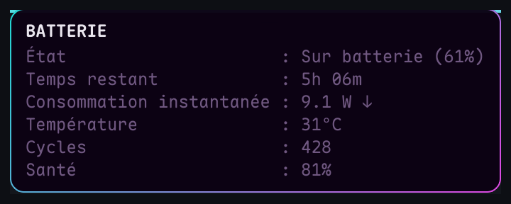
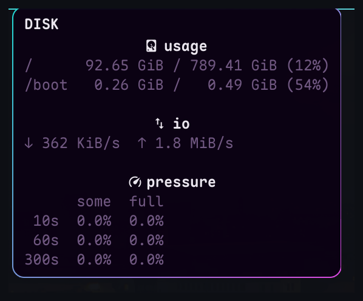

# YASSM — Yet Another Simple System Monitor

Version 1.29.38

[English](README.md) | **Français**

Un widget compact pour la barre d'Omarchy : CPU, RAM, swap, charge, GPU,
disque, réseau, température, batterie, uptime et alertes, chacun avec une
infobulle détaillée.

Dépôt : <https://github.com/jotenakis2/yassm>

## Captures


| Infobulles | |
| --- | --- |
|  |  |
|  |  |
|  |  |


D'autres dans [`docs/screenshots`](docs/screenshots).

## Installation

```bash
omarchy plugin add https://github.com/jotenakis2/yassm.git --enable
```

Le widget est activé dans sa section par défaut. Pour le déplacer :

```bash
omarchy plugin enable io.github.jotenakis2.yassm --section left
```

Utilisez `left`, `center` ou `right`.

## Ce qu'il affiche

| Module | Valeur |
| --- | --- |
| CPU | utilisation % |
| RAM | utilisée % |
| Swap | utilisée % (masqué sans swap) |
| Charge | file d'attente, en % normalisé par CPU (peut dépasser 100) |
| GPU | utilisation % ; `--%` si le système n'expose aucun compteur (ex. Apple Silicon) |
| Disque | utilisation de la racine % |
| Réseau | débits ↓ et ↑, ou icône barrée hors ligne |
| Température | capteur le plus chaud en °C |
| Batterie | niveau %, avec une icône d'état |
| Uptime | minutes sous une heure, puis `hMM` |
| Alertes | icône seule, quand une alerte est active |

L'ordre et la visibilité de chaque module sont configurables.

## Clics

| Clic gauche sur | Ouvre |
| --- | --- |
| CPU, charge, GPU, RAM, swap, température, uptime | `btop`, ou `htop` si `btop` manque |
| disque | le gestionnaire de fichiers par défaut (dossier personnel) |
| réseau | le **Test de débit** d'Omarchy |
| batterie | le menu **Système** d'Omarchy |
| alertes | la dernière heure de warnings/erreurs, puis les unités systemd en échec |

Le **clic droit** ouvre les **Réglages**. Un clic hors des modules garde la
cible générique : `btop`, puis `htop` ; les Réglages si aucun des deux n'est
installé.

## Infobulles

Survolez un module pour ses détails. **Données étendues** ajoute les lignes
marquées ci-dessous.

- **CPU** : utilisation par cœur ; top des processus utilisateur ; PSI et
  fréquences par cœur (étendu) ;
- **RAM** : total, utilisée, disponible ; top des processus utilisateur ;
  tampon, cache et PSI (étendu) ;
- **Swap** : usage par périphérique, détails zram et zswap (étendu) ;
- **Disque** : usage par système de fichiers local et montages NFS/CIFS
  (interrogés à l'ouverture de l'infobulle ; un montage qui ne répond pas en
  2 s est omis) ; débits d'E/S, PSI et E/S par processus (étendu) ;
- **Réseau** : débits et totaux de session ; interface, IP LAN et SSID ; les
  données étendues ajoutent l'IP WAN, la puissance et la fréquence Wi-Fi, ainsi
  qu'un ping de latence vers omarchy.org (à l'ouverture puis à chaque
  intervalle lent tant que l'infobulle reste ouverte) ;
- **Température** : tous les capteurs et ventilateurs, du plus chaud au plus
  froid ;
- **Batterie** : état et temps restant ; puissance, température du pack,
  cycles et santé (étendu) ;
- **Uptime** : temps depuis le démarrage ; âge et date d'installation
  (étendu) ;
- **Charge**, **GPU**, **Alertes** : résumé court, ou liste des alertes
  (unités en échec, zombies, disque/RAM).

Données étendues ajoute les fréquences et PSI CPU, les E/S disque et par
processus, les détails swap/zram/zswap, la puissance et la fréquence Wi-Fi, l'IP WAN, le
ping de latence NET, l'âge d'installation, et la puissance, la température, les
cycles et la santé de la batterie.

## Couleurs

Quand la case **Couleurs** est cochée (par défaut), les valeurs prennent les
couleurs verte/orange/rouge du thème ; décochée, elles gardent la couleur
normale de la barre. Les seuils s'appliquent à la valeur arrondie affichée :

| Module | Normale | Verte | Orange | Rouge |
| --- | --- | --- | --- | --- |
| CPU, RAM, swap, GPU | < 10 % | 10–32 % | 33–65 % | ≥ 66 % |
| Disque | < 20 % | 20–32 % | 33–89 % | ≥ 90 % |
| Charge | < 10 % | 10–49 % | 50–89 % | ≥ 90 % |
| Réseau | < 10 KiB/s | 10–499 KiB/s | 500–999 KiB/s | ≥ 1000 KiB/s |
| Batterie | ≥ 50 % | 20–49 % | 11–19 % | ≤ 10 % |
| Température | < 40 °C | 40–49 °C | 50–59 °C | ≥ 60 °C |

La batterie suit une logique inversée : plus la valeur baisse, plus la couleur
est alarmante. Les seuils sont modifiables par famille dans les Réglages. Avec
Couleurs, l'icône de batterie passe au vert sur secteur ; la valeur garde la
couleur normale de la barre.

## Alertes

Le module reste masqué tant que tout va bien : unité systemd en échec, zombie
de plus de 60 s, racine à 95 % ou plus, ou RAM à 95 % ou plus. Son icône donne
la gravité, l'infobulle en liste la cause. Il apparaît aussi lorsqu'un **outil
requis** manque, même si Alertes est désactivé.

## Réglages

Clic droit sur le widget. Le panneau a quatre sections :

- **Modules** : activer/désactiver, glisser la poignée pour réordonner ;
- **Affichage** : cadres, bordure, rayon des coins, couleurs, données
  étendues, espacements, processus affichés ;
- **Seuils** : utilisation, disque, charge, réseau, batterie, température.
  Masqués tant que **Couleurs** est désactivé ;
- **Intervalles** : échantillonnage rapide (1–5 s) et lent (5–30 s).

Les préférences sont stockées dans `~/.config/omarchy/shell.json`.

## Performances

YASSM est optimisé pour rester léger : environ **0,05 % de la machine** au
rafraîchissement par défaut (1 s), aucun processus résident, et les modules
masqués arrêtent l'échantillonnage. Mesures :
[performance-fr.md](performance-fr.md).

## Prérequis

Omarchy 4.x, `bash`, `awk`, coreutils, `findmnt`, `ps` et `systemd`. En option :
`btop` ou `htop` (cible du clic gauche), `curl` et `ip` (adresses réseau),
`nmcli` (fréquence Wi-Fi), `ping` (latence NET), `nvidia-smi` (GPU NVIDIA), UPower et
NetworkManager (batterie et SSID). Un outil optionnel manquant masque simplement le champ
correspondant.

Le widget nécessite une barre horizontale ; il est masqué sur une barre
verticale.

## Mise à jour

```bash
omarchy plugin update
```

Les réglages sont dans `shell.json` ; aucun fichier de configuration à
migrer.

## Désinstallation

```bash
omarchy plugin disable io.github.jotenakis2.yassm
omarchy plugin remove io.github.jotenakis2.yassm
```

`remove` supprime le dossier : poussez le dépôt ou gardez une archive avant.

## Licence

MIT — voir [`LICENSE`](LICENSE).
